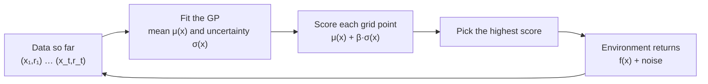
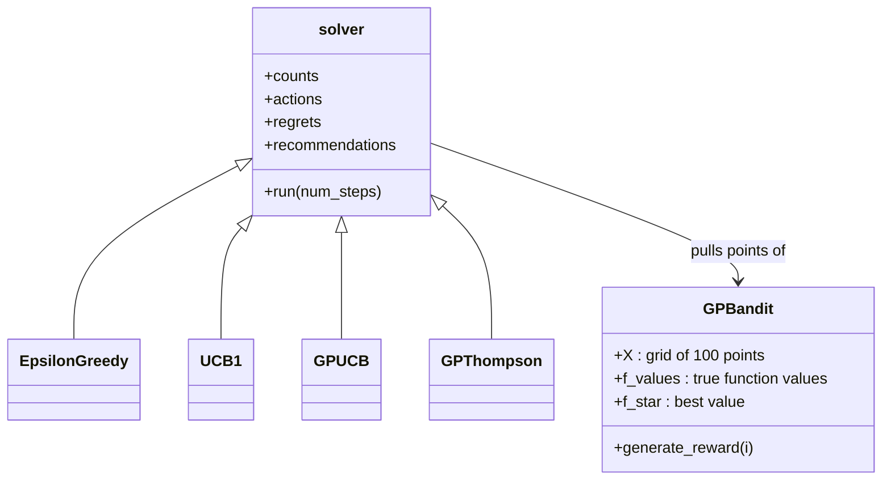
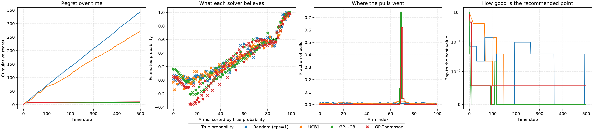

# 🔭 GP-UCB, by hand

A Gaussian-process bandit written from scratch in NumPy. It looks for the peak of an unknown 1-D function while paying as little as possible for the points it tries along the way.

Four solvers run on the same problem: **random**, **UCB1**, **GP-UCB** and **GP-Thompson**. The plots show how much a kernel helps when neighbouring points carry information about each other.

This is the second step of a learning path toward constrained, time-varying kernelized bandits for beam alignment (see [Where this is going](#-where-this-is-going)). The code favours readable names over clever tricks.

## 🙏 Credit and sources

I wrote this code while learning from these sources. Please look at the originals.

| What | Source |
|---|---|
| GP-UCB algorithm | Srinivas, Krause, Kakade, Seeger, [*Gaussian Process Optimization in the Bandit Setting*](https://arxiv.org/abs/0912.3995), ICML 2010 |
| `kernel` and `posterior` in `gp.py` | **Adapted from** Martin Krasser's [Gaussian processes notebook](https://github.com/krasserm/bayesian-machine-learning/tree/dev/gaussian-processes) (Apache-2.0). The function signatures, docstrings and equation numbers follow the notebook; the rest of the project is built on top of them. |
| Solver structure and the multi-panel result plot | Follow Lilian Weng's [multi-armed-bandit](https://github.com/lilianweng/multi-armed-bandit) repo and her post [*The Multi-Armed Bandit Problem and Its Solutions*](https://lilianweng.github.io/posts/2018-01-23-multi-armed-bandit/). That repo has no license file, so I did not copy its code; this is my own implementation. |
| The longer-term goal | Deng, Zhou, Ghosh, Gupta, Shroff, [*Interference Constrained Beam Alignment for Time-Varying Channels via Kernelized Bandits*](https://arxiv.org/abs/2207.00908), WiOpt 2022 |

The earlier step, plain multi-armed bandits, is in my [bandits-from-scratch](https://github.com/Ashwin9084/bandits-from-scratch) repo.

---

## 🧠 The problem

There is a hidden function `f(x)` on `[0, 5]` with two peaks: a **tall, narrow** one near `x = 3.5` and a **short, wide** one near `x = 1`. Each step a solver picks one of 100 grid points and gets back a noisy reading `f(x) + noise`. It never sees `f` itself.

```
f(x) = 1.0 · exp(−(x − 3.5)² / (2·0.3²))  +  0.6 · exp(−(x − 1.0)² / (2·0.6²))
reading = f(x) + Normal(0, 0.1²)
```

The score is **cumulative regret**: each step adds `f(best) − f(chosen)`, using the true `f`, not the noisy reading. A good solver's regret curve flattens.



**Why a GP helps.** With independent arms (as in the slot-machine repo), a reading at `x = 3.48` says nothing about `x = 3.43`. A GP with a smooth kernel does: one reading updates the belief about all nearby points. The bonus `β·σ(x)` is large where the GP has seen no data and small where it has, so unexplored regions keep attracting the solver until they're checked.

## 🧩 The four solvers

| Solver | How it picks the next point |
|---|---|
| **Random** (`EpsilonGreedy` with ε = 1) | Uniformly at random. This is the baseline to beat. |
| **UCB1** | Treats the 100 points as independent arms: `mean + sqrt(2·ln t / pulls)` |
| **GP-UCB** | `argmax μ(x) + β·σ(x)`, with μ and σ from the GP posterior (β = 2) |
| **GP-Thompson** | Draws one random function from the GP posterior and takes its argmax |

The GP uses a squared-exponential kernel `k(x, x') = σ_f² · exp(−(x − x')² / 2ℓ²)` with `ℓ = 0.5`, `σ_f = 1`, and noise `σ_y = 0.1` (the true noise level). These values were chosen by hand and not tuned.

```
μ(x)  = k_sᵀ (K + σ_y² I)⁻¹ y
Σ(x)  = k_ss − k_sᵀ (K + σ_y² I)⁻¹ k_s          σ(x) = sqrt(diag Σ)
```

## 🗂️ Code layout



| File | What's in it |
|---|---|
| `bandits.py` | `GPBandit`: the grid, the hidden two-peak function and the noisy `generate_reward` |
| `gp.py` | `kernel` and `posterior` (the GP in plain NumPy) |
| `solvers.py` | The base solver, `EpsilonGreedy`, `UCB1`, `GPUCB`, `GPThompson` |
| `helpers.py` | `report` (printed summary) and `plot_results` (four-panel figure) |
| `main.py` | Runs all four solvers on the same bandit and plots them |

Each solver also records a **recommendation** after every step: the point it would name as the best one right now. Plotting how far that recommendation is from the true best shows how quickly a solver *knows* where the peak is, which cumulative regret alone doesn't show.

## ▶️ Run it

```bash
pip install numpy matplotlib
python main.py
```

It uses 100 grid points and 500 steps (`seed=0`), prints a summary per solver, shows the figure and saves it as `results.png`. The two GP solvers take roughly 7 seconds each on my machine. `main.py` sets `OPENBLAS_NUM_THREADS=1` before importing NumPy; for matrices this small, multithreaded linear algebra costs more than it saves. Tested with Python 3.12, NumPy 1.26 and Matplotlib 3.8.

## 📊 Results



Left to right: cumulative regret, each solver's belief about the function (arms sorted by true value), the fraction of pulls each point received, and the gap between the best value and the value at the solver's current recommendation (log-like axis).

One run, 100 points, 500 steps, `seed=0` (the true best is `f* = 0.999` at `x = 3.48`):

| Solver | Final regret | Distinct points tried | Most-pulled points (pulls) | First step with a recommendation within 0.01 of the best |
|---|---|---|---|---|
| Random | 342.9 | 100 | spread evenly | 118 |
| UCB1 | 270.2 | 100 | 69 (14), 70 (14), 71 (14) | 101 |
| **GP-UCB** | **8.3** | **13** | **69 (372)**, 68 (66), 71 (26) | **5** |
| GP-Thompson | 9.3 | 15 | **69 (331)**, 70 (116), 68 (35) | 11 |

Point 69 is `x = 3.48`, the tall peak. The solvers' full per-point pull counts are printed by `main.py`.

### What the picture shows
- **The kernel is what matters.** UCB1 has to try all 100 points several times before it concentrates, and it still spreads its pulls widely. GP-UCB tried only 13 points, put 372 of 500 pulls on the best one, and its regret barely moves after the first dozen steps.
- **GP-UCB and GP-Thompson behave similarly here.** GP-UCB explores in a controlled, deterministic way. GP-Thompson explores through its random draws, so it checks a few more points and recommends the right one a little later.
- **Random sometimes "knows" the peak without exploiting it.** It visits every point, so its recommendation can be right, but each step costs it regret. That's why the recommendation-gap plot and the regret plot are shown together.
- **The belief panel** shows the GPs match the true curve well on the high-value side, where they sampled, and less well on the low side, where they didn't look. Exploration is spent where it matters.

### ⚠️ Caveats
- This is **one random seed**. Differences between the two GP methods (8.3 vs 9.3) are too small to call. Averaging over many seeds would be needed to compare them.
- The kernel's lengthscale, noise level and β were set by hand, and the GP is told the true noise level. A real problem would need them estimated.
- The hidden function is a toy chosen to have two different peaks.

## ⏱️ A note on speed

UCB1 takes under a second. The GP solvers are far slower, because each step refits the GP on **all** the data so far, which costs roughly the cube of the number of points; a whole run grows like the fourth power of the number of steps. For matrices this small the overhead of multithreaded BLAS made it several times slower still, hence the thread setting above. One fix I did not implement is to update a Cholesky factorisation by one row per step, which brings a step down to roughly the square of the number of points.

## 🗺️ Where this is going

The target is the algorithm in the paper above, which adds two things to GP-UCB:
1. **An interference constraint.** A second hidden function `g(x)`, with its own GP, must stay below zero on average. The solver maximises `UCB(f) − φ · LCB(g)`, where φ is updated by a projected gradient step each round.
2. **Time variation.** `f` and `g` drift over time, so the algorithm throws away all data every `W` rounds (restarts).

Next steps are the constrained version, then the restart, then a beam-alignment simulator.

## 📚 References
- N. Srinivas, A. Krause, S. Kakade, M. Seeger, *Gaussian Process Optimization in the Bandit Setting: No Regret and Experimental Design*, ICML 2010. [arXiv:0912.3995](https://arxiv.org/abs/0912.3995)
- Y. Deng, X. Zhou, A. Ghosh, A. Gupta, N. B. Shroff, *Interference Constrained Beam Alignment for Time-Varying Channels via Kernelized Bandits*, WiOpt 2022. [arXiv:2207.00908](https://arxiv.org/abs/2207.00908)
- M. Krasser, [*Gaussian processes*](https://github.com/krasserm/bayesian-machine-learning/tree/dev/gaussian-processes), bayesian-machine-learning.
- L. Weng, [*The Multi-Armed Bandit Problem and Its Solutions*](https://lilianweng.github.io/posts/2018-01-23-multi-armed-bandit/), Lil'Log, 2018.
